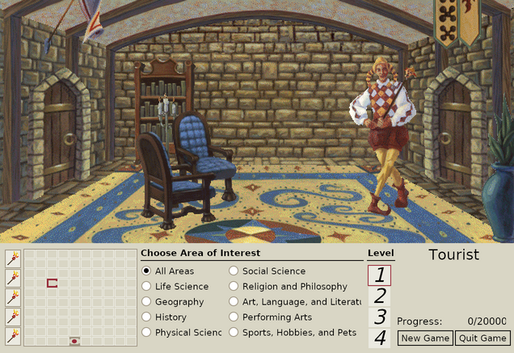

# mindmaze-port

Open-source port of **MindMaze** (also written *Mind Maze*), the castle trivia game from Microsoft Encarta
(Encarta 95, 97 ... 2006). Bring your own Encarta disc (2006, or 95 to 98); runs on Windows, Linux, macOS and Android.

> Not affiliated with or endorsed by Microsoft. Encarta and MindMaze are trademarks of Microsoft.
> This repository contains no Microsoft content: the pictures, sounds, music, questions and texts are read
> from **your own copy** of an Encarta disc by the extraction tool.



*Screenshot of the game running with data extracted from the maintainer's own Encarta 2006 disc.
It is the only Microsoft artwork in this repository.*

## What it is

A faithful re-implementation of the game as it shipped in Encarta 2006, written in portable C from a study
of the original program: the same maze generator and random sequence, rooms, characters, questions, scoring,
matches, awards and music logic. Deliberate changes are marked `CHANGE` in the source and listed in
[docs/RE-NOTES.md](docs/RE-NOTES.md). Additions, all optional:

- full screen and free window scaling (F11), crisp text at any size;
- HD (2x) and widescreen art you can make yourself from your extracted pictures (see [docs/HD-ART.md](docs/HD-ART.md));
- extra question sources: the questions of your other Encarta discs (Settings > "Add questions from a disc";
  questions already in another source are left out), open question packs (Open Trivia DB, OpenTriviaQA), your own
  questions, an online top-up (off by default), and "skip questions already seen" per player.

Watch the original: search YouTube for "Encarta MindMaze", or see
[Wikipedia: Microsoft Encarta](https://en.wikipedia.org/wiki/Encarta).

## Supported discs

Any one of these discs is enough (US English editions). The extractor finds MindMaze's room tables in each
edition's own program by patterns, so it does not depend on exact file versions.

| Edition | What is read | Notes |
|---|---|---|
| **Encarta 2006 Premium** | `EE/ENCARTA/`: ENCARTA.EXE, ENCARTAR.DLL, MINDMAZE.DB, .IDX, .EIT | reference edition, 8,020 questions |
| Encarta 98 (Win95 or Win98 edition, disc 1) | `ENCYC98/MMBAG.M20`, MINDMAZE.DB/.IDX, `MM/MIDI`, the program inside `SETUP.EXE` | 7,758 questions |
| Encarta 97 | `ENCYC97/MMBAG.M20`, MINDMAZE.DB/.IDX, `MM/MIDI`, `AAMSSTP/ENCARTA/ENC97.EXE` + `ENCRES97.DLL` | 9,035 questions |
| Encarta 96 (Macintosh) | the HFS disc: `Encarta Files/MindMaze *`, the application in `Installer Files` | 9,193 questions; the music (QuickTime music movies in `Encarta Files/MIDI`) is converted to MIDI files |
| Encarta 95 (MPEG edition) | `ENCYC95/MM/INTERACT/` (MM95BAG.M12, MM95.EXE, MINDMAZE.DB/.IDX), `MM/MIDI` | 9,198 questions; no title picture |

Pictures, sounds and the main music are the same in every edition; the questions differ, and some texts are
worded differently. The 95 to 98 discs also have extra music (transitions between the background tunes),
which the game plays when it is there. The plain (non-MPEG) Encarta 95 disc image we tested was incomplete.

For Encarta 2006 the extractor compares the files with these SHA-256 values and records any difference in
`data/manifest.json`:

| File on the disc | Bytes | SHA-256 |
|---|---|---|
| `EE/ENCARTA/ENCARTA.EXE` | 2,992,848 | `089adc5db30653e4af2d8a37072052c0bddc80049f9943e25b8d41d95905045f` |
| `EE/ENCARTA/ENCARTAR.DLL` | 7,723,728 | `5d1705d02996d94b973c634503ce63135aa77ad595e685a29dfd4416857708ef` |
| `EE/ENCARTA/MINDMAZE.DB` | 1,468,278 | `a28de3741a8cd16ed3959556470437d64d94b190fd79508146f0d60b87913a7e` |
| `EE/ENCARTA/MINDMAZE.IDX` | 64,304 | `0f16c38bae3ae23d6ca6a3d10eb4b110e1a39da1765c49f9dce34a4606aa04ba` |
| `EE/ENCARTA/MINDMAZE.EIT` | 2,924,179 | `b7e3ccec82048f57fc0a7f887569fcc1dce737cd58c113726394ea5287f8fc0e` |

The reference disc image (`MS Encarta 2006 Premium.iso`, 2,994,030,592 bytes):

| Hash | Value |
|---|---|
| SHA-256 | `2eae50a9c76c8ff5d2856fc8679ca045ad610662392772643d1c6e6811be08e8` |
| SHA-1 | `d8c2db418a491f16e04ce27e8ae44523288f459d` |
| MD5 | `33bda89e71dd84dc7dc15fe71b62797b` |

A different image of the same disc is fine. Other languages have not been tried; if the extractor refuses a
disc, please open an issue with its message.

## Quick start (Windows)

1. Download `MindMaze.exe` from [Releases](../../releases). That is the whole download; nothing else needs to be
   installed. It is not signed, so Windows SmartScreen warns once ("More info" -> "Run anyway").
2. Start it. On the first start it looks for an inserted or mounted Encarta disc; if there is none it asks
   for the disc image (`.iso`), or for `ENCARTA.EXE` (2006) or `MINDMAZE.DB` (95 to 98) on the disc.
3. It copies what the game needs into a `data` folder next to the exe (or `%LOCALAPPDATA%\MindMaze` when the
   exe's folder is not writable), which takes a few seconds, and starts. The disc is not needed afterwards.

Keys: F2 HD art, F3 widescreen (when that art is present, see below), F11 full screen. Settings: the button on the
castle-gate page, the gear in the top right corner of a room, or MindMaze menu > Settings...

## Quick start (Linux)

1. Download `MindMaze-linux-x86_64.tar.gz` from [Releases](../../releases) and unpack it (`tar xzf
   MindMaze-linux-x86_64.tar.gz`). Nothing needs to be installed: it runs on Ubuntu 22.04 or later, SteamOS, Debian 12,
   Fedora and other x86_64 desktops (X11 or Wayland).
2. Start `MindMaze/MindMaze`. On the first start it looks for a mounted Encarta disc (`/media`, `/run/media`, `/mnt`);
   if there is none it asks for the disc image (`.iso`), or for `ENCARTA.EXE` / `MINDMAZE.DB` on the disc. You can
   also give the image on the command line: `./MindMaze ~/Downloads/Encarta.iso`.
3. Everything stays in the unpacked `MindMaze` folder (`data/`, `mindmaze.ini`, the players): delete the folder and
   the game is gone. Only if that folder is read-only does the data go to `~/.local/share/MindMaze`
   (`$XDG_DATA_HOME/MindMaze`); data that 1.0.0 / 1.0.1 put there is still found and used.

The file dialog needs xdg-desktop-portal or zenity (every desktop has one; in Steam Deck's game mode start it once
from the desktop, or pass the image as above). Steam Deck: add `MindMaze` as a non-Steam game.

**Alternative:** run the Windows exe with Wine (`wine MindMaze.exe`), or add it to Steam as a non-Steam game and pick
Proton. A mounted disc is found through Wine's `Z:` drive; otherwise choose the `.iso` in the file dialog.

## Quick start (macOS)

1. Download `MindMaze-macos.zip` from [Releases](../../releases) and unzip it (Safari does this by itself). The app
   runs on Apple Silicon and Intel Macs, macOS 11 or later.
2. The app is not signed with an Apple developer ID, so macOS refuses the first double-click. Right-click (or
   Control-click) `MindMaze.app` > **Open** > **Open**; on macOS 15 and later instead open it once, then System
   Settings > Privacy & Security > **Open Anyway**. If macOS says the app "is damaged", remove the download
   quarantine in Terminal: `xattr -dr com.apple.quarantine MindMaze.app`.
3. On the first start it looks for a mounted Encarta disc or disc image in `/Volumes` (double-click the `.iso` in
   the Finder to mount it); otherwise it asks for the image or `ENCARTA.EXE` / `MINDMAZE.DB`. The data goes to
   `~/Library/Application Support/MindMaze`.

Keys on Linux and macOS: F2 HD art, F3 widescreen, F11 or Alt+Enter full screen; Ctrl+N (macOS: Cmd+N) new game,
Ctrl+M music on/off, Ctrl+E sound effects on/off, Ctrl+Q quit. The music plays through the bundled SoundFont
GeneralUser GS; more `.sf2` SoundFonts put in a `soundfonts` folder next to the `data` folder (e.g.
`MindMaze/soundfonts`) appear in Settings > "Music instruments".

## Command line (Windows, Linux, macOS)

Everything works from the game itself; the flags are for launchers and scripts. `MindMaze --help` lists them:

| Flag | |
| --- | --- |
| `-f`, `--fullscreen` / `--windowed` | start in full screen / in a window |
| `--hd`, `--no-hd`, `--wide`, `--no-wide` | HD pictures, widescreen view on / off (once made) |
| `--music <0-100>`, `--sound <0-100>` | volumes (0 = off) |
| `--no-title` | skip the title screen |
| `--classic` / `--modern` | all modern options off / on, for this run (see Modern options) |
| `--set <key>=<value>` | any `mindmaze.ini` setting |
| `--home <dir>` | keep everything (`data/`, `mindmaze.ini`, players) in `<dir>` |
| `--disc <path>` or just `<path>` | first start: the Encarta disc image, folder or a file on it; no questions asked |
| `--add-disc <path>` | add the questions of another Encarta disc |
| `--export <file.zip>` | write the data file for the phone app |
| `--prepare-art`, `--install-art` | write the HD / widescreen kit again; install finished pictures |
| `--update` | install the newest release now (checksum checked) |
| `--no-update-check` | do not look for a new version at start (for launchers that update the game themselves) |
| `--help`, `--version` | |

Game flags apply to that run only; the saved settings stay as they are (a change made in the game during the run is
saved as usual). The actions (`--add-disc`, `--export`, `--prepare-art`, `--install-art`, `--update`) run without a window and
exit: code 0 = done, 1 = failed (reason on stderr), 2 = wrong usage. With `--disc` they also build the data folder
first, so `MindMaze --home ~/Games/mm --disc Encarta.iso --prepare-art` sets everything up without a window.
`--opt=value` works as well as `--opt value`.

## Modern options

Settings > *Modern options* has six switches: **Continue unfinished games**, **Hints** (50/50, halves the points),
**Turn prompts and player stats**, **Layout** (Auto / Classic / Touch: big buttons beside the room; phones and tablets
play in landscape), **Large text and high contrast**, **Animations**. The *Classic MindMaze* switch turns them all off
(the game then plays and looks like the original) and back on as they were; `--classic` / `--modern` do the same for
one run.

## Updates

Every version looks for a newer release on GitHub when it starts and asks before doing anything: **Update now**
downloads the new version, checks its SHA-256 against the `.sha256` file of the release, puts it in place and
starts again; your data, players and settings stay. **Later** asks again next time.

- **Windows:** `MindMaze.exe` replaces itself (the old one is kept as `MindMaze.exe.old` until the next start).
  MindMaze menu > *Check for Updates...*; *Look for Updates at Start* switches the question off and on.
- **Linux:** the files in the unpacked `MindMaze` folder are replaced; *Don't ask again* switches the question off
  (`update_check=1` in `mindmaze.ini` switches it back on).
- **macOS:** `MindMaze.app` is replaced where it is. Move the app out of *Downloads* first (e.g. into
  *Applications*): macOS runs an app that was never moved from a read-only copy, which cannot be updated.
- **Android:** the app downloads the new APK and opens Android's install screen; tap *Update* there. The first
  time, Android asks you to allow MindMaze to install apps.

If the program's folder is read-only (e.g. `C:\Program Files`), MindMaze opens the release page instead.
Launchers that update the game themselves start it with `--no-update-check`.

For developers there is also a Python version of the extractor (`tools/extract/extract.py`, needs 7-Zip); both
write the same data folder.

## Android (sideload)

1. Download `MindMaze.apk` from [Releases](../../releases) and install it (allow installing from your browser or
   file manager when Android asks).
2. On the first start, import the game's data once, either way:
   - **Quickest:** on the PC, in the Windows game, Settings > *Export data for the phone app* writes one `.zip`
     (with your HD / widescreen pictures, if you made them). Copy it to the phone and choose *Import a MindMaze
     data file (.zip)*.
   - **Without a PC:** copy the disc image (`.iso`) or the five files from `EE\ENCARTA` to the phone and choose
     them; the app extracts them itself.
3. The data stays in the app; the zip or image can be deleted afterwards. Landscape only.

iPhone: the same app can be built for iOS (Capacitor), but only on a Mac; it would have to be sideloaded (AltStore /
Sideloadly with an Apple ID). Not released yet.

## HD and widescreen art (optional)

The game looks like the original out of the box. With an AI agent that can generate images (the prompts were
written for OpenAI Codex) you can make sharper 2x pictures and side extensions for a widescreen view from your
own extracted pictures. Nothing else needs to be installed: MindMaze prepares everything in its data folder on
the first start and installs the agent's results itself.

1. Open Codex (or a similar agent) on the game's `data` folder.
2. Give it **`data/art/START-HERE.txt`**. Its placeholders `<data-folder>` and `<which-art>` (HD, WIDESCREEN or
   BOTH) can be filled in first; if they are not, the agent asks you.
3. The agent paints the prepared sheets (`data/art/work/*/sheets`) into `data/art/work/*/out_gen`.
4. Start MindMaze again (or press Settings > Pictures > Install): it installs the new pictures by itself.
   F2 (menu "Use HD Art") switches between original and HD, F3 ("Widescreen") the wide view; the same switches
   are in Settings > Pictures, which also links to the how-to.

Details and the individual prompts: **[docs/HD-ART.md](docs/HD-ART.md)**,
[codex/START-HERE.txt](codex/START-HERE.txt), [codex/PROMPT.txt](codex/PROMPT.txt) (HD),
[codex/wide/PROMPT.txt](codex/wide/PROMPT.txt) (widescreen). The results are made from Microsoft's art, so keep
them for yourself.

**Token / usage note:** this is a lot of image generation: 28 sheets for HD and 20 for widescreen, each a
1536x1024 image, plus the model reading every sheet's notes and checking its results (widescreen allows a
second try per sheet). Expect it to use a large share of an AI plan's usage limits or a noticeable API bill.
Both prompts skip sheets that are already done, so you can stop when a limit is reached and continue later;
doing HD first and widescreen another day spreads the cost.

## Building

Everything builds on Linux, or in Docker on any system:

```
docker build -t mindmaze-port-dev docker/
docker run --rm -v "$PWD:/w" -w /w mindmaze-port-dev make test win32
```

| Command | What |
|---|---|
| `make test` | core tests on synthetic fixtures (no Encarta files needed) + extractor tests |
| `make test-data DATA=data` | the same core tests on your extracted data |
| `make win32` | `build/win32/MindMaze.exe` (mingw-w64 cross build) |
| `make linux` | `build/linux/MindMaze-linux-x86_64.tar.gz` (SDL3 linked in; in the image of `docker/linux.Dockerfile`, see below) |
| `make macos` | `build/macos/MindMaze-macos.zip` (universal app; on a Mac with SDL3 from `tools/build_sdl3.sh`, see `.github/workflows/release.yml`) |
| `make web`, `make android` | `build/web/` (WebAssembly engine) and `build/android/MindMaze.apk` |

The Linux build runs in an Ubuntu 22.04 image with SDL3 built from source (so the program also runs on older
systems):

```
docker build -t mindmaze-port-linux -f docker/linux.Dockerfile tools/
docker run --rm -v "$PWD:/w" -w /w mindmaze-port-linux make linux
```

## Repository layout

| Path | Contents |
|---|---|
| `src/core/` | the portable game (C11): maze, rooms, questions, panel, settings, tables loader |
| `src/extract/` | built-in extractor (disc image / folder -> data folder): ISO 9660, MS Help 2 archive + LZX, PE resources, ADPCM, SHA-256 |
| `src/platform/win32/` | Windows layer: window, GDI text, waveOut mixer, MIDI, ini, first-start setup |
| `src/platform/sdl/` | Linux and macOS layer (SDL3): window, input, audio stream, files, first-start setup |
| `src/platform/web/` | WebAssembly layer (in progress; engine of the Android app, not hosted anywhere) |
| `src/platform/common/` | shared by the SDL and web layers: text (stb_truetype), SoundFont music (TinySoundFont), zip export |
| `tools/extract/` | `extract.py` (Python reference extractor), `mmextract.c` (command-line front end of the built-in one), `mmdb.py` |
| `src/art/` | built-in HD / widescreen art tools: makes the sheets, installs the agent's results |
| `codex/`, `tools/art/` | the prompts; the reference Python versions of the art tools (developers) |
| `tools/packs/`, `packs/` | question pack importers and the open packs ([licences](packs/LICENSES.md)) |
| `tests/` | `test_core.c`, `test_extract.py`, `make_fixtures.py` (invented data) |
| `docs/` | [RE-NOTES.md](docs/RE-NOTES.md), [SPEC.md](docs/SPEC.md), [FORMATS.md](docs/FORMATS.md) |

## What is not in this repository

The Encarta disc's files and anything made from them: pictures, sounds, music, questions, UI texts, room
tables (`data/`), and AI-upscaled or widened versions of the pictures. `.gitignore` excludes them and CI
fails if one is committed (`tools/check_no_content.py`). Release downloads contain only the program.

## AI-assisted development

This project was developed with AI assistance. Most of the reverse engineering of the original program, the C
code, the tests and the documentation were written with Anthropic's Claude (Claude Code), directed, reviewed and
play-tested by the maintainer. The optional HD / widescreen art is made by an image-generating AI agent on the
player's side (the prompts in `codex/` were written for OpenAI Codex); no AI-made pictures are in this repository.

## Licence

Code: [MIT](LICENSE). Question packs: their own licences, see [packs/LICENSES.md](packs/LICENSES.md).

Bundled third-party parts (all free to redistribute): fonts Liberation Sans/Serif (SIL OFL 1.1) and TeX Gyre
Pagella (GUST Font License) in `fonts/`; stb_image, stb_image_write, stb_truetype (public domain / MIT) and
TinySoundFont (MIT) in `src/third_party/`; the Linux, macOS and web / Android music uses the SoundFont
[GeneralUser GS](https://github.com/mrbumpy409/GeneralUser-GS) by S. Christian Collins
([licence](soundfonts/LICENSE-GeneralUser-GS.txt)), downloaded at build time by `tools/fetch_soundfont.sh`. The
Linux and macOS builds link [SDL3](https://libsdl.org) (zlib licence), built from source by `tools/build_sdl3.sh`.
